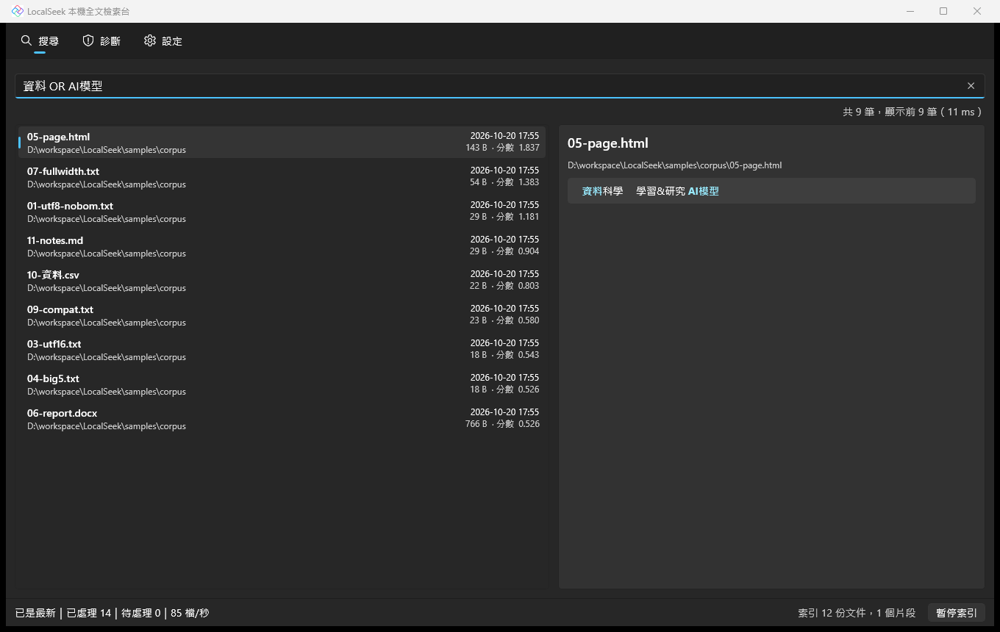
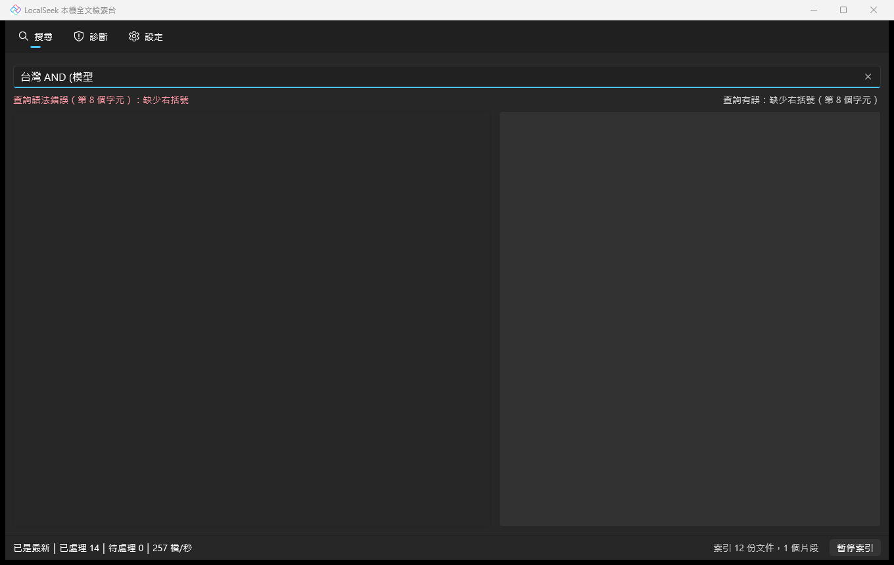
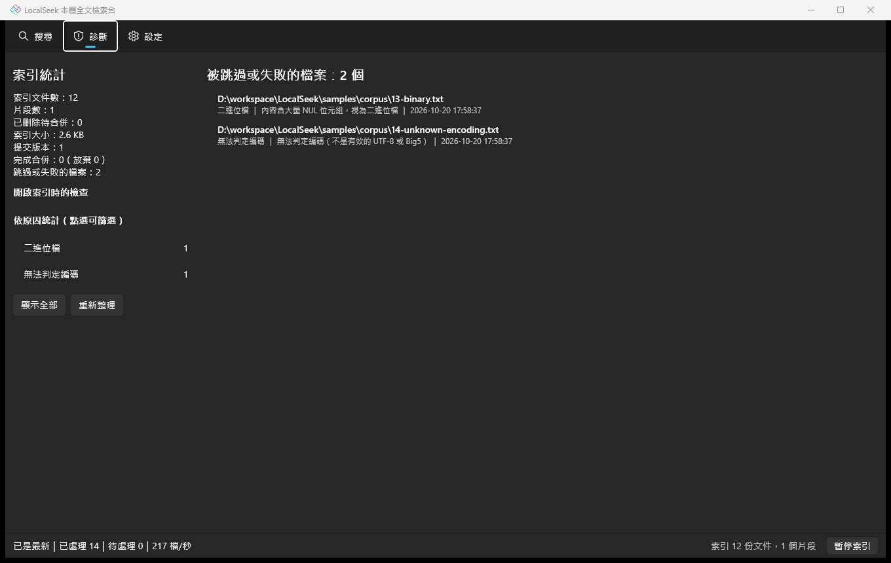
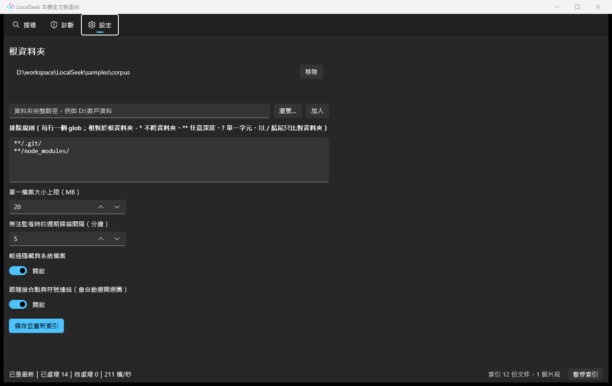

# LocalSeek 本機全文檢索台

[](https://github.com/hn83320589/LocalSeek/actions/workflows/ci.yml)

為小型工作室打造的 Windows 桌面全文檢索工具：秒搜中文與英文、標出命中位置、檔案存檔後約半秒即可搜到；
正確讀取 UTF-8、UTF-16、舊版 Big5、HTML 與 docx。索引格式、分詞、計分與合併皆為自行實作，
未使用 Lucene.NET、SQLite FTS 或任何現成全文檢索程式庫。

- C# / .NET 9、Uno Platform（Uno.Sdk 單一專案，WinAppSDK，unpackaged）
- 索引與設定位置：`%LocalAppData%\LocalSeek\`（可用環境變數 `LOCALSEEK_DATA_DIR` 改到別處，供展示或量測）



| 查詢語法錯誤 | 診斷頁 | 設定 |
|---|---|---|
|  |  |  |

---

## 目錄

1. [功能](#1-功能)
2. [建置與執行](#2-建置與執行)
3. [架構](#3-架構)
4. [索引檔格式](#4-索引檔格式)
5. [演算法](#5-演算法)
6. [測試](#6-測試)
7. [效能](#7-效能)
8. [設計取捨](#8-設計取捨)
9. [已知限制](#9-已知限制)
10. [驗收標準對照](#10-驗收標準對照)

---

## 1. 功能

### 索引範圍與檔案

- 多個根資料夾、glob 排除規則、暫停與恢復索引（狀態列按鈕）。
- 支援 `.txt .md .csv .log .json .xml .html .htm .docx`。
- 編碼偵測：BOM（UTF-8、UTF-16 LE/BE）→ NUL 比例 > 1%（前 64 KB）視為二進位 → 嚴格 UTF-8 → 嚴格 Big5（另檢查位元組結構）→ 無法判定則跳過並記錄原因。
- 超過大小上限（預設 20 MB）、二進位、無法判定編碼、docx 損毀者整份跳過（連檔名也不索引），原因顯示在診斷頁。
- HTML 略過 `<script>`、`<style>`、註解並解碼實體；行內標籤（`<b>`、`<span>`…）不切斷詞語。docx 只取 `word/document.xml` 的段落文字（不含頁首頁尾、刪除修訂、功能變數代碼）。
- 爬檔能承受接合點／符號連結迴圈、長路徑（> 260 字元）、被鎖定的檔案（1、2、4 秒後重試，三次後記為「持續被鎖定」）、權限不足、讀取途中被修改（稍後重讀）；任何單檔失敗都不會中止索引。

### 查詢語言

| 語法 | 說明 | 範例 |
|---|---|---|
| 詞 | 相鄰即隱含 AND | `台灣 大學` |
| `"片語"` | 詞元位置必須連續 | `"AI模型"` |
| `AND` `OR` `NOT` `-` `( )` | 優先序 NOT > AND > OR；運算子須大寫 | `(報告 OR 簡報) -草稿` |
| `abc*` | Latin 前綴（至少 2 字元） | `analy*` |
| `ext:` | 副檔名，不分大小寫、可加或不加句點 | `ext:docx` |
| `path:` | 完整路徑子字串，不分大小寫，`/` 與 `\` 相同 | `path:"客戶\2024"` |
| `modified:` | 本機日期 `>=`、`<=`、`=`（或省略） | `modified:>=2024-01-01` |
| `size:` | `<`、`>`，可加 KB、MB（1024 進位） | `size:<2MB` |

- 無空白的 CJK 字串會自動成為片語（`資料分析` ＝ 位置連續的 資料、料分、分析）；含單字詞元的字則成為各詞元的 AND（`A模B`）。
- 語法錯誤會顯示錯誤位置與說明，不會崩潰；只有排除條件的查詢（如 `-草稿`、`a OR -b`）會被拒絕。

### 介面

- 輸入即搜尋（150 ms 防抖；新輸入立即取消舊查詢，舊結果不會覆蓋新結果）。
- 結果清單虛擬化，預覽窗格最多 3 個片段、每段 ≤ 120 字元，命中處以粗體強調色標示（含檔名命中）。
- 鍵盤：`Ctrl+K` 聚焦搜尋、`↑` `↓` `PageUp` `PageDown` `Ctrl+Home` `Ctrl+End` 選取、`Enter` 以預設程式開啟、`Alt+Enter` 在檔案總管中顯示、`Esc` 清除。
- 狀態列顯示進度、速率、待處理數；診斷頁列出索引統計、開啟索引時的檢查結果、依原因分類的被跳過或失敗檔案。

---

## 2. 建置與執行

需求：Windows 10 19041 以上（x64）、[.NET SDK 9.0.x](https://dotnet.microsoft.com/download/dotnet/9.0)。不需另外安裝 Windows App SDK（發佈檔為 self-contained）。

```powershell
git clone https://github.com/hn83320589/LocalSeek.git
cd LocalSeek
dotnet build LocalSeek.sln -c Release
dotnet test tests/LocalSeek.Tests -c Release

# 執行（unpackaged）
dotnet run --project src/LocalSeek.App -f net9.0-windows10.0.19041

# 發佈 win-x64（與 CI 上傳的 artifact 相同）
dotnet publish src/LocalSeek.App/LocalSeek.App.csproj -c Release -f net9.0-windows10.0.19041 -r win-x64 -p:PublishProfile=win-x64 -o artifacts/publish/win-x64
```

第一次啟動後到「設定」加入根資料夾並按「儲存並重新索引」。

### 工具

```powershell
# 產生 50,000 份平均約 20 KB 的混合語料（UTF-8±BOM、UTF-16、Big5、HTML、docx、CSV、Markdown）
dotnet run -c Release --project tools/LocalSeek.CorpusGen -- --out D:\perf\corpus --count 50000 --mixed

# 量測效能（建立索引、開啟、查詢 P95、記憶體峰值、存檔到可搜尋）
dotnet run -c Release --project tests/LocalSeek.Perf -- --corpus D:\perf\corpus --work D:\perf\work
```

產生的語料與索引不放進 Repo。

---

## 3. 架構

```
LocalSeek.Core            net9.0   分詞、查詢解析/綁定/執行、BM25、摘要、索引檔格式、片段、合併、快照
   ▲
LocalSeek.Indexing        net9.0   編碼偵測與抽取、glob、爬檔、監看、增量索引引擎、設定、診斷
   ▲
LocalSeek.App.ViewModels  net9.0   搜尋/狀態/診斷/設定 VM、AppHost（無 UI 的組合根）
   ▲
LocalSeek.App             Uno      檢視與平台服務（開啟檔案、在檔案總管中顯示、UI dispatcher）

tests/LocalSeek.Tests     xUnit    單元、性質、故障注入、壓力、ViewModel、範例語料手算驗證
tests/LocalSeek.Perf      console  效能量測
tools/LocalSeek.CorpusGen console  語料產生
```

`LayeringTests` 確保 Core、Indexing、ViewModels 不引用任何 UI 或 Windows 專用組件。可替換的邊界：

| 介面 | 正式實作 | 測試替身 |
|---|---|---|
| `IIndexStorage`（建立、寫入、flush、原子改名、刪除、列舉、隨機讀） | `FileSystemIndexStorage` | `FakeIndexStorage`（故障注入、模擬當機、torn write） |
| `ISourceFileSystem` | `PhysicalSourceFileSystem` | `FakeSourceFileSystem`（接合點、鎖定、讀取中修改、權限） |
| `IFileWatcherFactory` | `FileSystemWatcher` | `FakeFileWatcherFactory` |
| `TimeProvider` | `TimeProvider.System` | `FakeTimeProvider` |
| `IUiDispatcher`、`IShellService` | DispatcherQueue、Process | `QueueDispatcher`、`FakeShell` |

### 資料流

```
 FileSystemWatcher ─┐                       ┌─ 讀檔 → 雜湊 → 抽取 → 分詞（8 個 worker 平行）
 溢位 / 網路磁碟 ───┼─► IndexingEngine ─────┤
 啟動 / 週期掃描 ───┘   只標記「髒」路徑      ├─ 改名／移動：IndexWriter.Rename（不抽取、不分詞）
                        防抖後對照實際狀態    └─ 刪除：墓碑
                                                     │
                                         IndexWriter（單一寫入者）
                                         RAM 片段 → 不可變片段檔 → manifest 原子切換
                                                     │                  └─ 背景合併
                                         IndexSnapshot（ref count）◄── 搜尋、預覽
```

---

## 4. 索引檔格式

目錄 `%LocalAppData%\LocalSeek\index\`，所有 I/O 都經過 `IIndexStorage`。

| 檔案 | 內容 |
|---|---|
| `manifest_{gen:D10}.lsm` | 提交點：UTF-8 JSON（格式版本、generation、下一個片段編號、片段清單與各自的墓碑版本）＋ 長度 ＋ CRC32 ＋ magic `LSEKMAN\0` |
| `seg_{id:D8}.lss` | 不可變片段 |
| `seg_{id:D8}_{delGen:D6}.lsd` | 不可變墓碑 bitset：magic、版本、片段編號、文件數、bitset、CRC32 |
| `*.tmp` | 寫入中的暫存檔，開啟時清除 |

### 片段檔（little-endian；varint 為 LEB128）

```
Header(32)  "LSEKSEG\0" | version u16 | reserved | segmentId i64 | reserved
Contents    count, [bodyLength varint, contentHash u64]                       ← 內文以 content 為單位
Docs        count, [path, size, lastWriteTicks, nameLength, contentSegment, contentId]
Postings    每個詞：[doc 差值, tf]* 緊接 [位置差值]*（逐文件）
TermDict    每 64 個詞一個區塊，前綴壓縮：[共用長度, 後綴, df, postings 長度, positions 長度]
TermIndex   每個區塊的第一個詞與位移（開啟時載入記憶體）
Footer      5 × (offset, length, CRC32) | headerCrc | footerCrc | "LSEKEND\0"
```

- 詞的鍵 ＝ `[TermSpace 位元組] + UTF-8`，依位元組排序。四種空間：內文詞元（含位置）、檔名詞元（含位置）、內文單字詞頻、檔名單字詞頻。
- **文件與內容分離**：Docs 記錄路徑、metadata 與檔名欄位，並以 `(contentSegment, contentId)` 指向內文 postings 所在的 Content，可以在別的片段。內容未變的改名只寫一筆新 Doc，原 Doc 加墓碑，內文不重新抽取也不重新分詞。
- 開啟時只驗證 header、footer、Contents、Docs、TermIndex 的 CRC（快）；TermDict 與 Postings 的 CRC 由 `VerifySegments()` 完整讀取驗證。

### 提交協定（任何時間點中止都一致）

1. 寫入新的片段檔與墓碑檔並 flush。
2. 寫 `manifest_N.tmp` 並 flush。
3. 原子改名為 `manifest_N.lsm`，這一步就是提交點。
4. 不再被任何提交、工作集或開啟中快照引用的檔案才刪除；刪除前先關閉檔案 handle，刪除失敗會記下並重試。

開啟時：選最新且校驗成功的 manifest（保留前一個提交作為退路）；它沒引用的檔案都是孤兒，直接刪除。
損毀或版本不符的片段只丟掉該片段，連同內容在那裡的文件，並立刻提交修復；隨後的差異掃描會把這些檔案補回來，所以只重建受影響的部分。
若所有 manifest 都無法讀取，回報「需要完整重建」並從空索引開始，程式不會崩潰。

---

## 5. 演算法

### 正規化與分詞

- 以「正規化單元」（一個 code point 加上其後的組合記號）為單位做 NFKC → 小寫（invariant）→ 臺→台。每個輸出字元都記住它的原始範圍 `[start, end)`，所以詞元可以還原到原始文字座標，即使 ㈱ → (株)、fi → fi 改變了長度。
- 單一 BMP 字元的正規化結果有快取，ASCII 與常用漢字不必呼叫 `string.Normalize`。
- Latin 詞元為連續 `[a-z0-9]`；CJK 區段長度 L ≥ 2 產生 L−1 個重疊雙字詞元，L = 1 產生單字詞元；其餘字元是分隔符，不佔位置。每個漢字另計「單字詞頻」。
- 單字詞元不存 postings（查單一漢字時依規定使用單字詞頻），但計入文件長度。
- 原始座標的性質（決策 A）：取出的子字串正規化後**包含**該詞元，且範圍最小；不含會變長字元的文字則**完全相等**。

### 查詢

`Parse`（語法樹保留原始字串）→ `Bind`（用 tokenizer 轉成 term、char、phrase、prefix、filter）→ `Execute`。
參考解用自己的 tokenizer 綁定同一棵語法樹，所以兩邊共用資料型別，但不共用分詞實作。
「只有排除條件」採有界性判斷：AND 中任一子節點有界即有界，OR 須所有子節點有界，NOT 取其 De Morgan 對偶。

### 執行與計分

- **term-at-a-time**：每個詞項先算出 `int[] tf`（內文 + 2 × 檔名），布林結構轉成 bitset，再對命中文件以正向詞項計分。
- 片語：先只用 postings 求出所有詞都出現的候選文件；接著只解碼候選文件的位置（其他文件的 varint 直接跳過）；最後用單向合併計算連續的起始位置數。
- BM25 變形：`idf = ln(1 + (N − df + 0.5) / (df + 0.5))`，`k1 = 1.2`，`b = 0.75`。N、Σlen、df 都是快照當下由現存文件精確計算的整數；相同詞項只計一次，依固定順序加總。同分依完整路徑（OrdinalIgnoreCase）排序。
- 取消：每 4096 筆 postings、每 1024 個片語候選檢查一次，取消在 50 ms 內生效（有測試）。

### 摘要與高亮

預覽時重新抽取檔案並分詞（索引只存位置，不存 offset），找出每個正向詞項的原始範圍，合併重疊或相鄰的範圍。
接著以貪婪法挑出最多 3 個互不重疊、各 ≤ 120 字元的視窗：優先涵蓋最多「尚未顯示的不同詞項」的視窗，結果依文件順序輸出。視窗邊界不會切斷代理對。

### 增量索引

- 事件只負責把路徑標為「髒」：每個路徑靜默 500 ms 後處理，但從第一個事件起最多延遲 1.5 秒。處理時讀取檔案的實際狀態再決定動作，所以遺失、重複或亂序的事件都不會造成錯誤。
- 改名與移動：
  - watcher 回報的改名（大小與修改時間相同）直接改路徑。
  - 被回報成「刪除＋新增」的跨資料夾移動，或差異掃描發現的移動，以大小加原始位元組 XxHash3 配對。
  - 資料夾改名會展開成每個檔案的改名。
  - 以上都不抽取、不分詞（以計數器斷言）。
- 只改了時間戳的檔案（位元組相同）只更新 metadata。
- 緩衝區溢位、網路磁碟或無法監看的根資料夾，改用差異掃描（網路磁碟每 5 分鐘一次）。

### 片段、合併與快照

- 寫入者把變更累積在 RAM 片段（預設 64 MB）與記憶體中的墓碑，提交時一次可見。
- 分層合併（MergePolicy）：同一層累積 10 個片段就合併成一個上一層的片段，片段數量因此維持在 O(log N)。刪除比例高的片段會單獨重寫。合併以 k-way 串流進行，記憶體有上限。
- 合併的重活在 writer lock 之外執行。提交合併時：
  - 帶入合併期間發生的刪除。
  - 還在 RAM 中、指向被合併內容的改名文件會被重新指向。
  - 若已提交的外部文件仍指向被合併的內容，放棄這次合併，下次再試。
  - 選取片段時，若被合併的內容由集合外的文件擁有，會先把該文件的片段一併納入，所以不會留下懸空參照。
- 快照（`IndexSnapshot`）採 ref count，固定一個 generation。之後的提交與合併都不會改變它看到的內容，它引用的檔案也要等它釋放後才刪除。

---

## 6. 測試

`dotnet test tests/LocalSeek.Tests`：**472 個測試案例**，在開發機上約 9 秒跑完。

**參考解與假檔案系統的獨立性**
- `tests/LocalSeek.Tests/Reference/` 是不建索引、直接掃描記憶體中所有文件的引擎。它有自己的 tokenizer（整串先 NFKC 再逐 code point 掃描，不追蹤座標）、自己的 binder、布林求值、片語計數、篩選與 BM25 計算。
- 它與正式程式碼只共用資料型別：語法樹、bound query record、`QuerySyntaxException`。
- `Fakes/` 裡的 `FakeIndexStorage`、`FakeSourceFileSystem`、`FakeFileWatcherFactory` 都是獨立實作。

**性質測試**：共 12 組，固定種子；失敗時訊息附上 `LOCALSEEK_SEED=…`，設定該環境變數即可單獨重現。

| 性質 | 驗收 |
|---|---|
| tokenizer 與參考 tokenizer 的詞元、位置、單字詞頻一致 | 1 |
| 原始範圍包含詞元且最小；不含會變長字元的文字完全相等；不切斷代理對 | 2 |
| 320 份文件 × 2000 條以上隨機查詢的命中集合（含 binder 是否拒絕查詢） | 5 |
| 片語出現次數（含跨文字系統） | 6 |
| 單一漢字與前綴的 tf、df | 7 |
| 分數相對誤差 ≤ 1e-9，排序完全一致 | 9 |
| 隨機新增、修改、刪除、改名、合併後，分數等於只含現存文件的參考解 | 10 |
| 增量更新（含資料夾改名與溢位）收斂到從零重建 | 11 |
| 合併前後結果不變、片段數 O(log N)、墓碑清除 | 16 |
| 摘要的數量、長度、順序，高亮的精確度與合併 | 18 |

**其他重點測試**
- 故障注入：對 7 種提交或合併情境的**每一個** I/O 操作注入故障，各在有與無 torn write 下模擬當機後重開，並測試復原過程本身再次當機（#15）。
- 快照隔離（#14）、損毀與版本不符（#19）、並行壓力（#17）。
- 真實磁碟上的 `mklink /J` 迴圈、長路徑與鎖定檔案（#13）。
- ViewModel 測試使用假時鐘與假 dispatcher（#20）；取消延遲在兩萬份文件的索引上實測。
- 範例語料手算驗證（`samples/expected`）。

---

## 7. 效能

完整報告見 [docs/perf-results.md](docs/perf-results.md)。

**測量環境**
- CPU：Intel Core i7-13700。量測程式把行程限制在 16 個邏輯處理器，也就是 8 個 P-core 含超執行緒，以對應題目的 8 核開發機；索引平行度為 8。
- 記憶體 32 GB、NVMe SSD、Windows 11 Pro 10.0.26200、.NET 9.0.17（Release）。
- 語料：`CorpusGen --mixed` 產生的 50,000 個檔案，共 944 MB，平均 19.3 KB。

| 項目 | 結果 | 限制 |
|---|---|---|
| 完整建立索引（含合併完成） | 109 s（抽取、分詞、寫入、提交 87 s） | ≤ 240 s |
| 記憶體峰值（Working Set） | 398 MB | ≤ 600 MB |
| 開啟既有索引 | 142 ms | ≤ 2 s |
| 兩詞 AND，P95（300 條） | 1.4 ms | ≤ 100 ms |
| 片語，P95（300 條） | 43 ms | ≤ 100 ms |
| 存檔到可被搜尋（含 500 ms 防抖，10 次） | 平均 545 ms，最大 566 ms | ≤ 3 s |

查詢從實際文件的文字中隨機抽詞組成，所以每條查詢都有命中。片語調校前的 P95 是 118 ms；改成「先以 postings 求候選，再只解碼候選文件的位置」之後降到 43 ms。

---

## 8. 設計取捨

| 決策 | 理由 | 代價 |
|---|---|---|
| 文件與內容分離（Doc → Content 參照） | 改名或移動時內文不重新抽取、不重新分詞 | 合併時要處理跨片段參照（closure 或放棄後重試） |
| 統計值在快照當下重新計算，不預存 df | 不可能用到過時的 N、avgdl、df | 每次查詢多掃一次 postings（10 萬份文件內負擔很小） |
| 索引只存位置，摘要時重新抽取 | 索引小約一半 | 預覽需要再讀一次檔案；檔案已變時以當下內容為準 |
| term-at-a-time 加稠密陣列 | 簡單、易驗證，10 萬份文件內足夠快 | 文件數到百萬級時需要改用 doc-at-a-time 或 skip list |
| 保留最近兩個提交 | 最新 manifest 損毀時可以退回前一版 | 被取代的片段晚一個提交才刪除 |
| 開啟時只驗證小區段的 CRC | 開啟時間 142 ms | 大區段損毀要等到 `VerifySegments()` 才會發現 |
| 預設跳過隱藏與系統檔（決策 D） | 避開 Office 暫存檔 `~$*.docx` 等雜訊 | 可在設定中關閉 |
| 跟隨連結但以 canonical 路徑去重；目標在根內的連結略過（決策 C） | 迴圈必定終止，也不會重複索引 | 只能經由連結到達的根內路徑，會以實際路徑顯示 |
| glob 比對完整相對路徑（決策 E） | 與規格一致 | `*.tmp` 只排除根目錄下的檔案，要排除全部須寫 `**/*.tmp` |
| 單一 CJK 字詞項用單字詞頻、片語的 tf 也乘 2 套用到檔名 | 依假設事項 | — |

---

## 9. 已知限制

- **Big5 誤判**：位元組結構合法的其他雙位元組編碼（例如部分 GBK 文字）可能被當成 Big5 解讀。
- **UTF-16 無 BOM**：依規格不支援，會因 NUL 比例被判為二進位。
- **正規化單元**：以「base + 組合記號」為單元，少數跨單元組字（例如諺文字母 Jamo）的座標會偏寬；這些字元都是分隔符，不影響詞元。
- **watcher 延遲期間的統計值**：從檔案刪除到提交（約 0.5 至 1.5 秒）之間，統計值仍包含該檔案。
- **長路徑與檔案總管**：超過 260 字元的路徑可以索引與搜尋，但 `explorer /select` 可能無法定位。
- **只支援單一執行個體**：題目不要求處理多開。
- **量測時的作業系統快取**：開啟時間是在同一行程建索引後量測的，屬於暖快取；冷啟動時磁碟讀取會稍慢。

---

## 10. 驗收標準對照

| # | 位置 |
|---|---|
| 1 | `Text/TokenizerExpectedFileTests` + `TestData/tokenizer-expected.json` |
| 2 | `Text/TextNormalizerTests`、`Properties/TokenizerProperties` |
| 3 | `Extraction/ExtractionTests` |
| 4 | `Query/QueryParserTests`、`Query/QueryBinderTests` |
| 5、6、7、9 | `Properties/SearchProperties` |
| 8 | `Query/FilterTests` |
| 10、16 | `Properties/IndexProperties`、`Index/MergeTests` |
| 11 | `Properties/IncrementalProperties` |
| 12 | `Pipeline/IndexingEngineTests`（改名、移動、資料夾改名、掃描偵測移動的計數器斷言） |
| 13 | `Crawling/CrawlerTests`（假 FS）、`Crawling/PhysicalFileSystemTests`（實測） |
| 14 | `Index/SnapshotIsolationTests` |
| 15 | `Index/FaultInjectionTests` |
| 17 | `Index/ConcurrencyStressTests` |
| 18 | `Search/SnippetTests`、`Properties/SnippetProperties` |
| 19 | `Index/CorruptionTests` |
| 20 | `ViewModels/SearchViewModelTests`、`ViewModels/CancellationLatencyTests` |
| 21 | `Settings/GlobTests`、`Settings/SettingsStoreTests` |
| 22 | `tests/LocalSeek.Perf`、[docs/perf-results.md](docs/perf-results.md) |
| 23 | `ViewModels/OtherViewModelTests`（計數一致）、上方診斷頁截圖（實測） |
| 24 | 472 個測試案例，含 12 組性質測試 |
| 25 | 本文件、[samples/expected/README.md](samples/expected/README.md)、[docs/architecture.md](docs/architecture.md) |
| 26 | `.github/workflows/ci.yml` |
